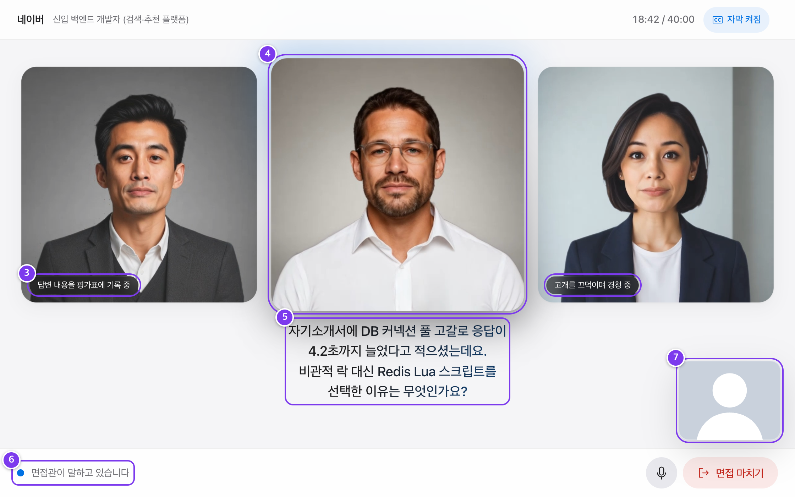
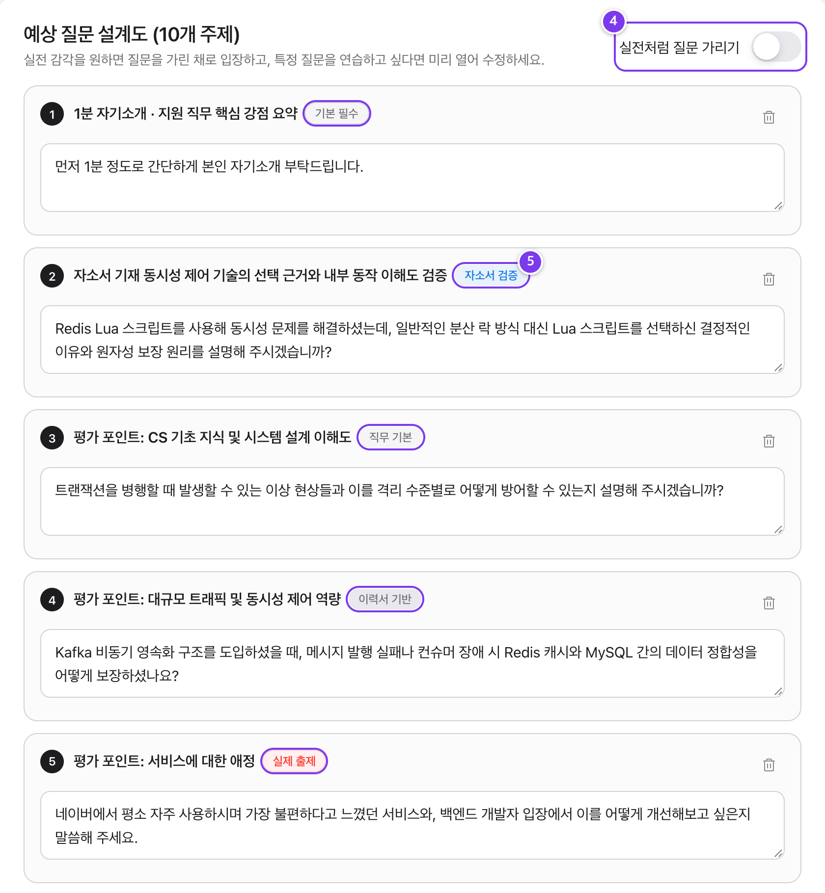
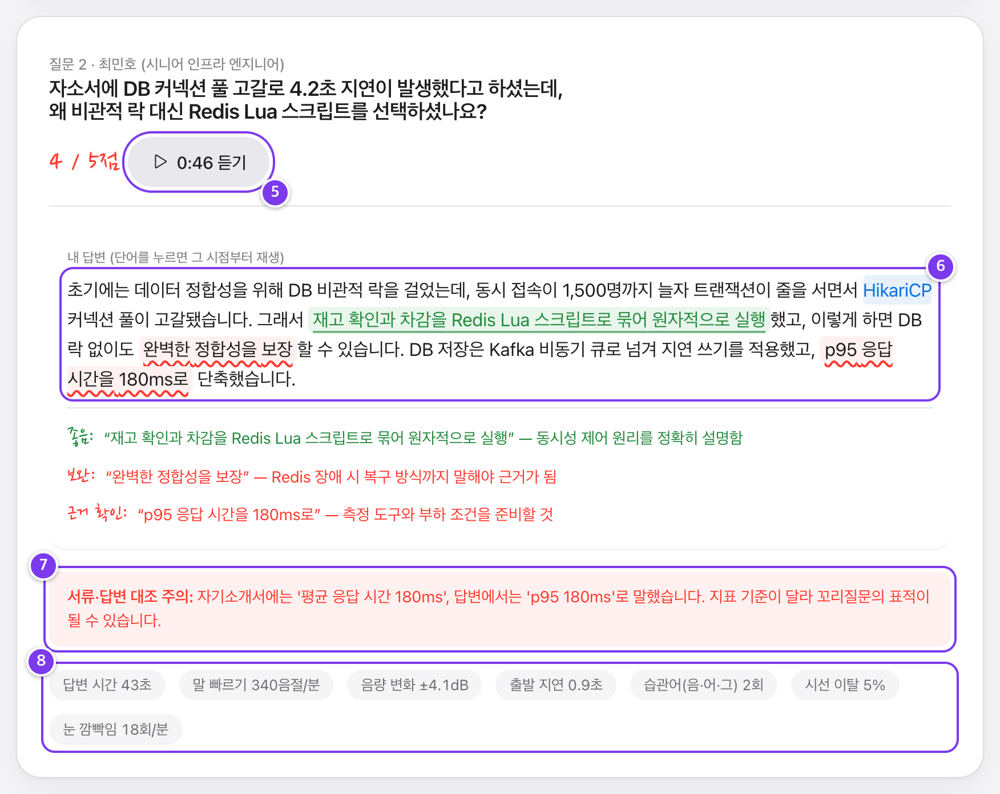

<div align="center">


# Moting (모팅)

### AI 다대일 실시간 모의면접 플랫폼
**Real-Time AI Multi-Interviewer Mock Interview Platform**

[](https://nextjs.org/)
[](https://react.dev/)
[](https://www.typescriptlang.org/)
[](https://tailwindcss.com/)
[](https://ai.google.dev/)
[](https://deepgram.com/)
[](https://simli.com/)
[](LICENSE)

<br/>

실제 면접 후기 데이터셋(186건)을 바탕으로 지원 기업·직무의 면접 환경을 재현하고,  
WebRTC 립싱크 아바타 3인 패널과 실시간 꼬리질문으로 실전 압박을 체감한 뒤,  
단어 단위 동기화 오디오 첨삭 리포트로 답변을 복기하는 오픈소스 모의면접 솔루션입니다.

[상세 기능 및 화면 가이드 (docs/FEATURES.md)](docs/FEATURES.md) •
[빠른 시작](#빠른-시작-quick-start) •
[시스템 아키텍처](#시스템-아키텍처) •
[데이터셋 안내](#면접-후기-데이터셋)

</div>

---

## 미리보기 (Preview)

<div align="center">
  
  <p><em>실시간 WebRTC 립싱크 아바타 3인 패널, 실시간 VAD 발화 감지 및 질문 자막 스트리밍</em></p>
</div>

<div align="center">

| 예상 질문 설계도 & 면접 설정 | 단어 단위 오디오 첨삭 채점표 |
| :---: | :---: |
|  |  |
| *기출 질문 배지 및 면접 압박도 설정* | *단어 클릭 시 해당 구간 즉시 재생 & 서류 모순 검출* |

</div>

---

## 개요 및 비교

기존 AI 모의면접 솔루션의 구조적 한계를 실제 면접 데이터와 웹 표준 실시간 미디어 기술로 개선했습니다.

| 구분 | 기존 AI 모의면접 솔루션 | Moting (모팅) |
| :--- | :--- | :--- |
| **면접 환경** | 모든 기업에 동일한 획일적 기본 질문 반복 | **초기 후기 186건 기반 기업·직무 분위기 및 기출 매칭** |
| **면접관 구성** | 1인 챗봇 또는 1인 음성 대화 | **최대 3인 다대일 패널 (직함·음성·성향·압박도 분리)** |
| **인터랙션** | 정적 일러스트 또는 텍스트 자막 UI | **WebRTC 실시간 립싱크 비디오 아바타 + 대기 제스처 연출** |
| **답변 복기** | 전체 긴 녹음 파일 처음부터 재생 | **단어 클릭 시 해당 순간 즉시 재생 + 형광펜/빨간펜 첨삭** |
| **모순 검증** | 단순 단어 어휘/문법 체크 | **제출 서류(자소서/이력서)와 실제 구두 답변 간 모순 검출** |
| **개인정보** | 영상 데이터를 클라우드 서버로 전송/저장 | **브라우저 온디바이스 MediaPipe 분석 (영상 외부 미전송)** |

---

## 핵심 기능 (Key Features)

### 1. 전방위 서류 파싱 및 구조화 (`/new`)
- 공고 URL 자동 크롤링 및 텍스트 직접 입력 지원
- PDF, DOCX, HWP, HWPX 드래그 앤 드롭 파싱 (브라우저 및 서버 직접 파싱)
- 지원 회사, 모집 부문, 필수 요건, 프로젝트 성과 수치 자동 추출

### 2. 기출 후기 매칭 & 질문 설계도 (`/setup/[id]`)
- `gemini-embedding-001` 기반 256차원 벡터 유사도 + 키워드 하이브리드 검색으로 유사 면접 후기 매칭
- 면접관 수(1~3인), 답변 제한시간(60~120초), 압박 강도(1~5단계), 말 끊기 빈도 제어
- `[실제 출제]`, `[자소서 검증]`, `[이력서 기반]`, `[공고 역량]` 근거 배지 부여
- 실전 감각 유지를 위한 질문 블라인드 모드 기본 적용

### 3. 실시간 다대일 화상 면접실 (`/interview/[id]`)
- **WebRTC 립싱크 아바타 (Simli Trinity-2)**: 면접관별 외형과 목소리가 동기화된 얼굴 모션 송출
- **초저지연 음성 인터랙션**: 마이크 입력 -> Deepgram Nova-3 전사 -> Gemini 3.5 Flash-Lite 꼬리질문 판단까지 평균 1.2초 내 응답
- **인터럽트 (Barge-in) & 침묵 감지**: 지원자가 말하기 시작하면 즉시 면접관 음성 중단, 2초 이상 침묵 구간 자동 기록
- **온디바이스 비전 분석**: MediaPipe Face Landmarker를 브라우저 내부에서만 구동하여 시선 이탈률과 눈 깜빡임 측정

### 4. 다시 듣기 첨삭 평가표 (`/report/[id]`)
- **인터랙티브 오디오 타임라인**: 침묵 구간, 초과 구간을 시각화하고 클릭 즉시 해당 위치 재생
- **단어 단위 하이라이트 동기화**: 전사된 문장의 단어를 누르면 그 단어를 말한 순간부터 오디오 재생
- **서류 불일치 경고**: 서류에 기재한 수치나 프로젝트 경험과 어긋나는 구두 답변 실시간 적발
- **정량 지표 리포트**: WPM(발화 속도), 음량 데시벨 편차, 출발 지연 시간, 추임새 통계 제공

### 5. 후기 수집 및 데이터 환류 루프 (`/reviews`, `/admin`)
- 면접 후 실제 기출 질문 및 후기를 등록하는 환류 구조
- 관리자 검수 승인 즉시 차기 면접장 생성 데이터셋에 자동 편입

---

## 시스템 아키텍처

```
┌────────────────────────────────────────────────────────────────────────┐
│                       Client (Desktop Browser)                         │
│  ┌───────────────────────┐  ┌──────────────────┐  ┌─────────────────┐  │
│  │ AudioWorklet (16kHz)  │  │ MediaPipe Vision │  │ Simli WebRTC    │  │
│  │ VAD & Buffer          │  │ On-device Gaze   │  │ Video Player    │  │
│  └───────────┬───────────┘  └─────────┬────────┘  └────────▲────────┘  │
└──────────────┼────────────────────────┼────────────────────┼───────────┘
               │ Audio Stream           │ Metrics            │ Video Stream
               ▼                        │                    │
┌───────────────────────────┐           │           ┌────────┴───────────┐
│ Deepgram Nova-3           │           │           │ Simli Trinity-2    │
│ Streaming STT (WebSocket) │           │           │ Real-time LipSync  │
└──────────────┬────────────┘           │           └────────▲───────────┘
               │ Transcripts            │                    │ PCM Audio
               ▼                        ▼                    │
┌────────────────────────────────────────────────────────────┼───────────┐
│ Next.js 16 Server API                                      │           │
│  ┌───────────────────────┐       ┌───────────────────────┐ │           │
│  │ Director Agent        │──────▶│ Gemini TTS            │─┘           │
│  │ (Gemini 3.5 Flash-Lite)│       │ (Voice Synthesis)     │             │
│  └───────────────────────┘       └───────────────────────┘             │
│              ▲                                                         │
│              │ Context & Question Blueprint                            │
│  ┌──────────────────────────────────────────────────────────────────┐  │
│  │ Ingestion & Evaluation Engine (Gemini 3.8 Flash)                 │  │
│  │ Embedding Matcher (gemini-embedding-001)                         │  │
│  │ Hybrid Store (Local .data/ or Supabase)                          │  │
│  └──────────────────────────────────────────────────────────────────┘  │
└────────────────────────────────────────────────────────────────────────┘
```

### AI 모델 및 엔진 매트릭스

| 기술 / 모델 | 역할 | 특징 |
| :--- | :--- | :--- |
| **Gemini 3.8 Flash** | 서류 구조화, HWP/PDF 분석, 질문 설계, 종합 채점 | 멀티모달 고속 인텔리전스 |
| **Gemini 3.5 Flash-Lite** | 실시간 턴 지휘 및 문맥형 꼬리질문 생성 | 극초저지연 추론 (< 400ms) |
| **Gemini 3.8 Flash-Lite TTS** | 면접관 페르소나별 자연스러운 음성 합성 | 한국어 억양 및 남/여 보이스 |
| **gemini-embedding-001** | 면접 후기 256차원 벡터 매칭 | 고정밀 코사인 유사도 검색 |
| **Deepgram Nova-3** | 실시간 스트리밍 한국어 STT, 단어 타임스탬프, VAD | 단어별 초 단위 오디오 타임스탬프 |
| **MediaPipe Face Landmarker** | 브라우저 온디바이스 시선/눈 깜빡임 추출 | 외부 서버 전송 없는 프라이버시 보호 |
| **Simli Trinity-2** | WebRTC 실시간 오디오-립싱크 비디오 스트리밍 | 음성에 동기화된 얼굴 영상 실시간 재생 |

---

## 면접 후기 데이터셋

모팅은 실제 취업 준비생 및 이직자들의 검증된 후기 데이터를 내장하고 있습니다.

- **전체 후기 건수**: **186건**
- **수록 대표 기업**: 네이버(44), 삼성전자(39), 카카오(37), LG전자(30), SK하이닉스(10), 토스(6), 한국전력(6), ETRI(5), 한전KDN(5), KISA(4)
- **실제 기출 질문**: **217개** (별도 직무별 공통 기본 질문 2,269개 탑재)
- **데이터 위치**: `data/moting/interview_reviews.jsonl`

---

## 빠른 시작 (Quick Start)

### 1. 사전 요구사항 (Prerequisites)
- **Node.js**: v20.0.0 이상
- **npm** (또는 pnpm / yarn)
- 최신 버전의 **Google Chrome** 브라우저 권장 (WebRTC 및 Web Audio API 지원)

### 2. 저장소 클론 및 패키지 설치
```bash
# 1) 저장소 클론
git clone https://github.com/leeyunseokarchive/moting.git
cd moting

# 2) 의존성 패키지 설치
npm install
```

### 3. 환경변수 설정
`.env.example` 파일을 복사하여 `.env.local`을 생성합니다.

```bash
cp .env.example .env.local
```

`.env.local` 파일을 열고 사용할 API 키를 입력합니다:

```env
# Google AI Studio API 키 (Gemini 3.8 Flash, TTS, Embedding)
GEMINI_API_KEY=your_gemini_api_key_here

# Deepgram Console API 키 (실시간 한국어 STT)
DEEPGRAM_API_KEY=your_deepgram_api_key_here

# Simli API 키 (실시간 WebRTC 립싱크 아바타)
SIMLI_API_KEY=your_simli_api_key_here

# 관리자 대시보드 비밀번호
ADMIN_PASSWORD=admin
```

> **참고 (Zero-Config 데모 모드)**:  
> 외부 API 키가 설정되지 않은 경우에도 Moting은 자체 내장된 **Mock/Demo Fallback 엔진**을 통해 핵심 기능(서류 분석, 사전 구성 질문 면접, 채점 리포트)을 중단 없이 시연해 볼 수 있도록 설계되었습니다.

### 4. 로컬 개발 서버 실행
```bash
npm run dev
```

브라우저에서 **[http://localhost:3000](http://localhost:3000)** 으로 접속하면 바로 모팅을 이용하실 수 있습니다.

---

## 주요 스크립트 (CLI Commands)

```bash
npm run dev      # Next.js 로컬 개발 서버 실행 (포트 3000)
npm run build    # 프로덕션 빌드 생성
npm run start    # 프로덕션 서버 실행
npm test         # Vitest 단위 테스트 실행
npm run lint     # ESLint 정적 코드 분석
npx tsc --noEmit # TypeScript 정적 타입 검사
```

---

## 디렉토리 구조 (Directory Structure)

```text
moting/
├── data/                         # 내장 면접 후기 및 기출 질문 데이터셋
│   └── moting/
│       ├── company_profiles.json # 주요 기업 인재상 및 프로필
│       ├── interview_reviews.jsonl # 186건 면접 후기 원본 데이터셋
│       └── questions/            # 직무별 공통 기출 질문 풀
├── docs/                         # 상세 개발 문서 및 캡처 에셋
│   ├── FEATURES.md               # 캡처본 기반 기능 및 화면 상세 가이드
│   └── images/                   # 보고서 및 문서용 고해상도 캡처 이미지
├── public/                       # 정적 에셋 (로고, 면접관 프로필 등)
│   ├── logo.png
│   └── portraits/                # 면접관 4인 초상화 이미지
├── src/
│   ├── app/                      # Next.js App Router (페이지 및 API 엔드포인트)
│   │   ├── page.tsx              # 서비스 랜딩 페이지
│   │   ├── new/page.tsx          # 1단계: 채용공고 및 서류 등록
│   │   ├── setup/[id]/page.tsx   # 2단계: 면접관 패널 및 질문 설계도 구성
│   │   ├── interview/[id]/page.tsx # 3단계: 실시간 다대일 화상 면접실
│   │   ├── report/[id]/page.tsx  # 4단계: 단어 단위 오디오 첨삭 채점표
│   │   ├── reviews/page.tsx      # 면접 후기 등록 페이지
│   │   ├── admin/page.tsx        # 관리자 후기 검수 대시보드
│   │   └── api/                  # 서버리스 API 라우트
│   ├── client/                   # 브라우저 전용 실시간 오디오/비디오 엔진
│   │   ├── interview/engine.ts   # 턴 관리 및 상태 머신
│   │   ├── audio/                # Web AudioWorklet, PCM 리샘플러, 레벨 미터
│   │   ├── avatar/simli.ts       # Simli WebRTC 연결 관리자
│   │   ├── stt/deepgram.ts       # Deepgram 스트리밍 WebSocket 클라이언트
│   │   └── vision/face.ts        # MediaPipe 온디바이스 얼굴/시선 추적
│   ├── components/               # 재사용 UI 컴포넌트
│   └── lib/                      # 핵심 비즈니스 로직 및 파이프라인
│       ├── pipeline/
│       │   ├── ingest.ts         # 서류 추출 및 구조화 엔진
│       │   ├── matcher.ts        # 면접 후기 벡터 임베딩 매칭
│       │   ├── setup.ts          # 면접관 페르소나 및 질문 설계도 생성
│       │   ├── director.ts       # 실시간 발화 지휘 및 꼬리질문 생성기
│       │   └── evaluator.ts      # 답변 채점 및 서류 모순 검증 엔진
│       ├── env.ts                # 환경변수 로더 및 프로바이더 판별
│       └── types.ts              # Zod 스키마 및 TypeScript 타입 정의
├── supabase/                     # (선택) Supabase 연동 시 DDL 스키마
│   └── schema.sql
├── tests/                        # Vitest 단위 테스트
└── vitest.config.mts
```

---

## 추가 문서 (Documentation)

- [**기능 및 화면 상세 가이드 (docs/FEATURES.md)**](docs/FEATURES.md): 최종 보고서 세부내용 기반 13개 고해상도 캡처 및 화면별 상세 인터랙션 설명서

---

## 기여하기 (Contributing)

기여는 언제나 환영합니다. 버그 제보, 기능 제안, PR(Pull Request) 모두 열려 있습니다.

1. 저장소를 Fork 합니다.
2. 기능 브랜치를 생성합니다 (`git checkout -b feat/amazing-feature`).
3. 변경 사항을 커밋합니다 (`git commit -m 'feat: add amazing feature'`).
4. 브랜치에 푸시합니다 (`git push origin feat/amazing-feature`).
5. Pull Request를 생성합니다.

---

## 라이선스 (License)

이 프로젝트는 [MIT License](LICENSE)에 따라 자유롭게 사용, 수정, 배포할 수 있습니다.
