# Moting (모팅) — 기능 및 화면 상세 가이드

> 본 문서는 실제 최종 결과보고서의 **세부 내용** 및 **개발 결과**를 바탕으로, 모팅(Moting)의 주요 단계별 동작 원리와 화면 UI/UX, 기술적 아키텍처를 상세하게 기술합니다.

---

## 1. 서비스 개요

**모팅(Moting)**은 초기 데이터셋인 **실제 면접 후기 186건**을 기반으로 면접관 수, 면접관 성향, 실제 기출 질문까지 지원 기업 및 직무의 실제 면접과 최대한 동일한 환경을 구성하는 **AI 다대일 실시간 모의면접 플랫폼**입니다. 지원자는 실전과 거의 동일한 압박 및 분위기에서 면접을 미리 치르며 실전 대응력을 극대화할 수 있습니다.

```
[서류 등록 및 분석] ──▶ [면접 후기 매칭] ──▶ [면접관·질문 설계도] ──▶ [실시간 화상 면접] ──▶ [단어 단위 첨삭 리포트]
```

---

## 2. 단계별 기능과 화면 UI/UX

※ 화면에 표시된 지원자 정보 및 면접 대화는 시연 및 검증용 예시 데이터입니다.

### 1) 서류 등록과 면접장 구성

지원자는 채용공고, 자기소개서, 이력서/경력기술서를 업로드하여 AI 분석 파이프라인을 실행합니다.

| 1-1. 서류 등록 화면 | 1-2. 면접장 구성 진행 화면 |
| :---: | :---: |
| 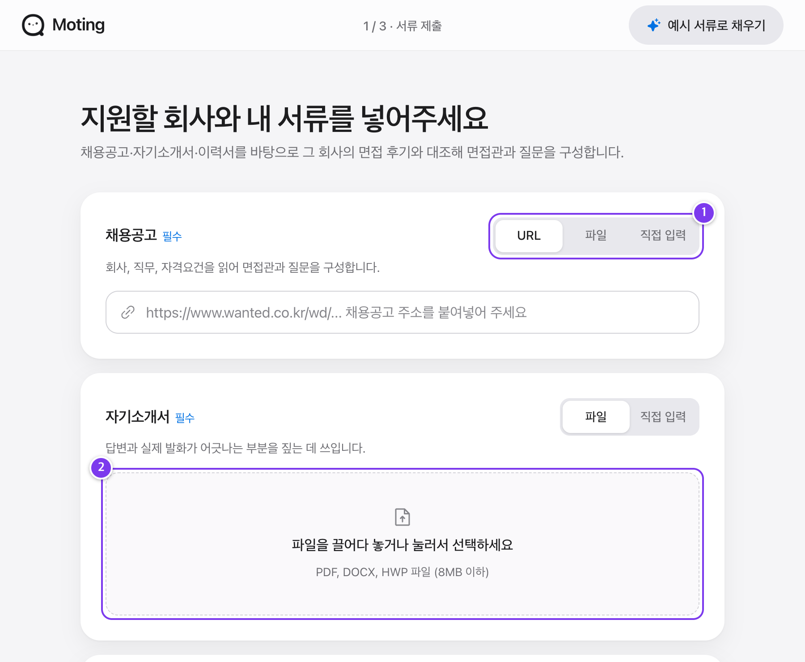 | 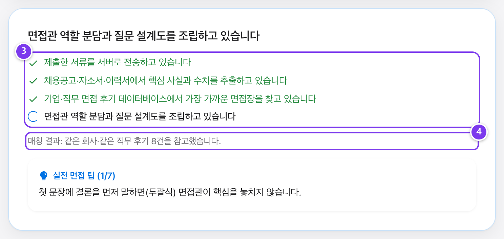 |

- **① 입력 방식 선택**: 서류 유형에 따라 최적의 입력 방식을 제공합니다. 채용공고는 **URL 추출**, **파일 업로드**, **직접 입력** 중 선택할 수 있으며, 자기소개서와 이력서는 파일 업로드 또는 직접 입력을 지원합니다.
- **② 광범위한 파일 포맷 파싱**: PDF는 물론 공공기관 및 국내 기업에서 빈번히 쓰이는 **HWP, HWPX, DOCX** 파일을 드래그 앤 드롭으로 파싱합니다.
- **③ 파이프라인 진행 상태 시각화**: `서류 전송` ➔ `핵심 사실·수치 추출` ➔ `면접 후기 매칭` ➔ `면접관·질문 구성` 4단계 파이프라인 진행률을 실시간 단계 표시기로 제공합니다.
  - 서류에서 지원 회사, 모집 부문, 자격 요건, 프로젝트 성과 수치, 핵심 기술 스택을 정형 데이터로 구조화합니다.
- **④ 후기 매칭 근거 투명성**: 시스템이 참고한 면접 후기의 범위와 건수를 사용자에게 표시하여, 어떤 실제 기출 데이터를 바탕으로 면접장이 구성되었는지 근거를 투명하게 제공합니다.

---

### 2) 면접장 환경 설정과 질문 설계도

실제 후기를 기반으로 자동 도출된 면접장 환경과 질문 설계도를 확인하고, 사용자 맞춤형으로 미세 조정할 수 있습니다.

| 2-1. 면접 환경 및 면접관 패널 설정 | 2-2. 예상 질문 설계도 화면 |
| :---: | :---: |
| 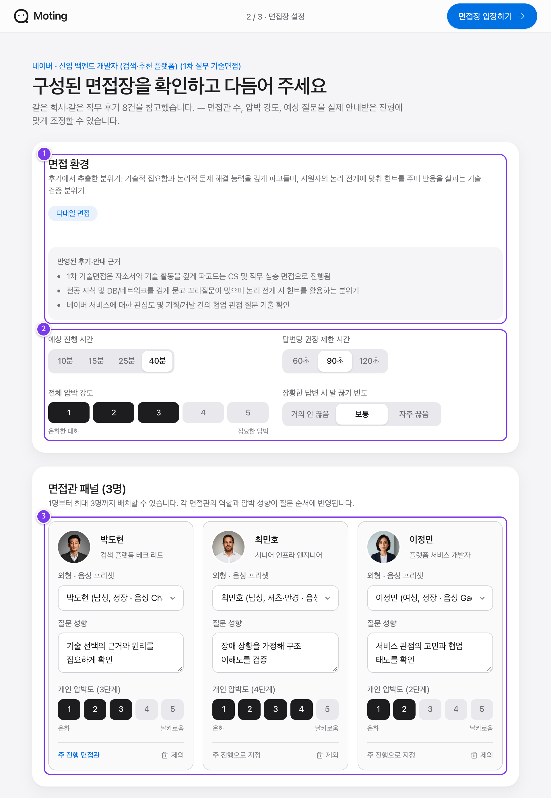 | 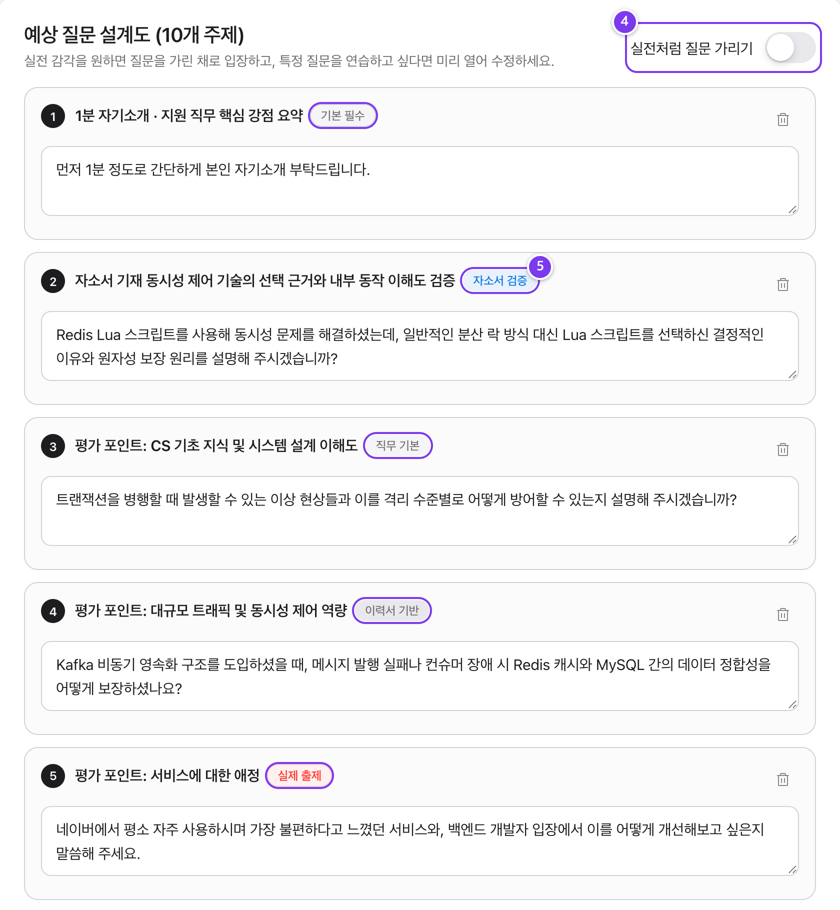 |

- **① 후기 매칭 근거 및 분위기**: 동일 기업 및 직무의 실제 면접 후기 사례와 후기에서 도출된 면접장 분위기(압박형, 직무 중심, 온화한 분위기 등)를 요약 제공합니다.
- **② 실전 면접 조건 세부 조절**: 실제 후기 평균치를 바탕으로 최적값이 자동 프리셋되며, 세그먼트 컨트롤러를 통해 세부 조건을 변경할 수 있습니다:
  - 총 면접 소요 시간: 10분 ~ 40분
  - 문항당 답변 제한 시간: 60초 ~ 120초
  - 체감 압박 강도: 1단계(온화) ~ 5단계(극단적 압박)
  - 장황한 답변 시 말 끊기 빈도 제어
- **③ 최대 3인 다대일 면접관 패널**: 1인부터 최대 3인의 다대일 면접관을 배치할 수 있습니다. 면접관마다 직함(실무 팀장, 임원, HR 담당자), 외형 아바타, 음성 보이스, 질문 성향, 압박도를 독립적으로 부여합니다.
- **④ 실전 질문 블라인드 모드**: 실전 긴장감을 위해 기본적으로 예상 질문이 블라인드 처리(가림막)됩니다. 토글을 해제하면 질문을 사전에 확인하거나 직접 편집·추가·삭제할 수 있습니다.
- **⑤ 출처 배지 시스템**: 생성된 각 질문의 도출 근거를 뱃지로 명확히 표시합니다:
  - `[실제 출제]`: 해당 기업/직무 기출 질문 데이터셋 일치
  - `[자소서 검증]`: 자기소개서 내용 진위 판별용 질문
  - `[이력서 기반]`: 경력기술서 및 프로젝트 성과 검증 질문
  - `[공고 역량]`: 채용공고의 필수/우대 역량 검증 질문
  - `[직무 기본]`: 해당 직군 필수 기본기 질문

---

### 3) 실시간 화상 면접실

브라우저 내 WebRTC 립싱크 아바타와 초저지연 음성 상호작용을 통해 실전과 같은 몰입감을 제공합니다.

| 3-1. 면접 전 장비 점검 | 3-2. 면접관 실시간 발화 | 3-3. 지원자 음성 답변 |
| :---: | :---: | :---: |
| 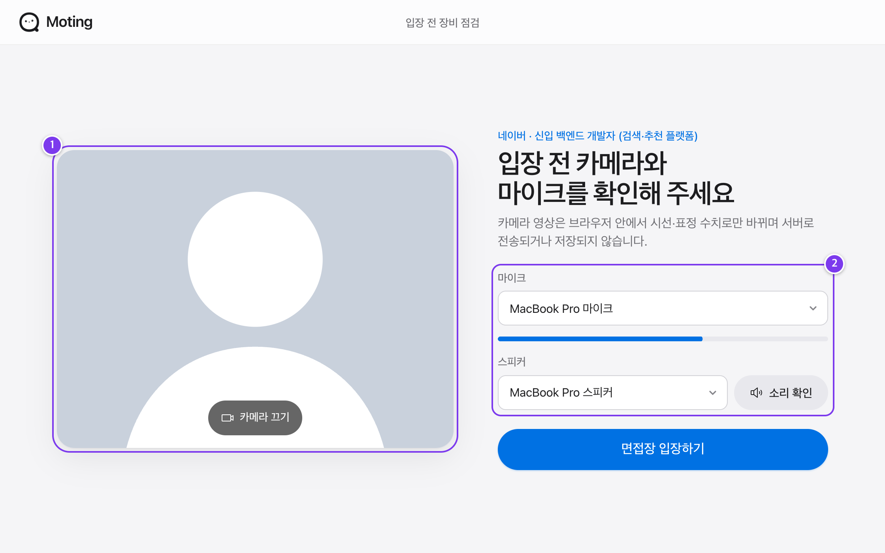 | 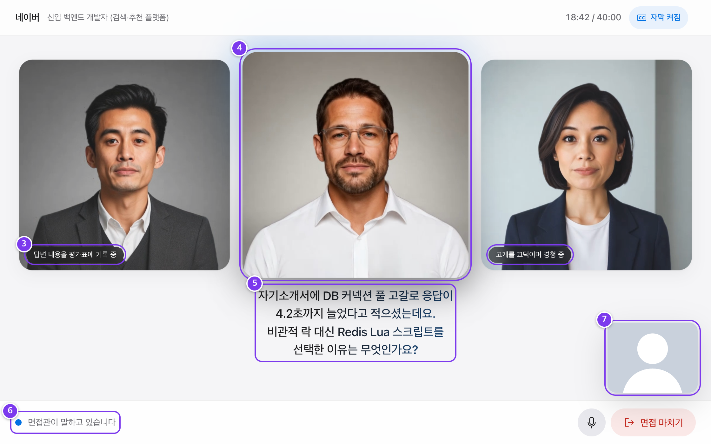 | 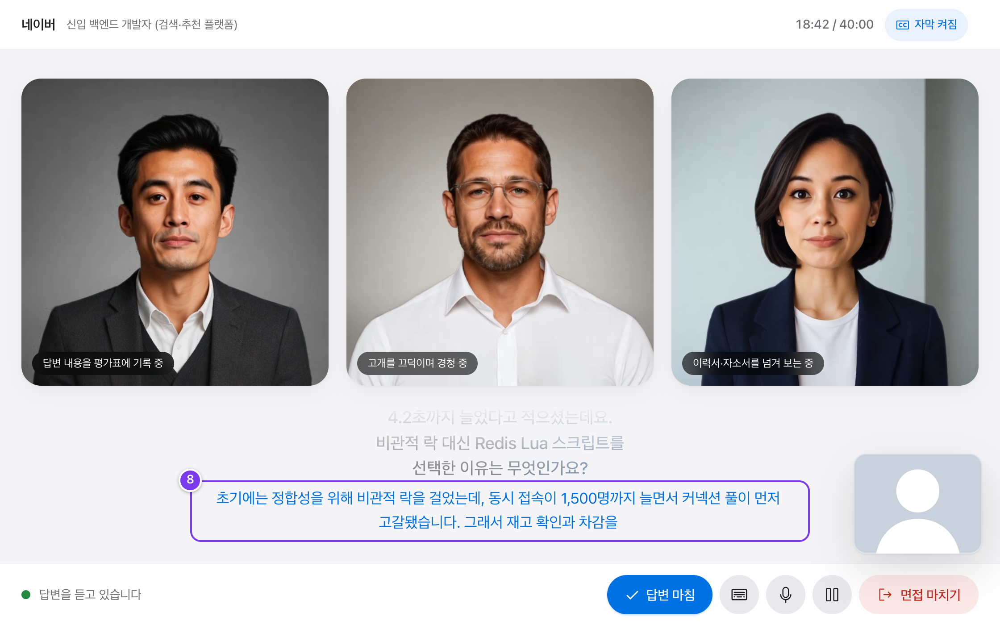 |

- **① 로컬 카메라 미리보기**: 입실 전 자신의 화면 구도와 조명을 확인합니다. 웹캠 영상은 일체 외부 서버로 전송되지 않으며 저장되지 않습니다.
- **② 마이크 / 스피커 점검**: 실시간 입력 레벨 게이지(dB) 및 음향 테스트 버튼으로 마이크와 스피커 상태를 완벽히 확인 후 입실합니다.
- **③ 면접관 대기 제스처 연출**: 발언하지 않는 다른 면접관들도 고정된 이미지가 아닌, `답변 내용을 평가표에 기록 중`, `고개를 끄덕이며 경청 중` 등 생생한 대기 인터랙션 상태를 유지합니다.
- **④ 발화 면접관 포커싱 & 립싱크 아바타**: 질문하는 면접관 화면이 확대되고 포커스 링이 켜지며, WebRTC 기반의 실시간 립싱크 아바타가 자연스러운 입모양과 음성으로 질문합니다.
- **⑤ 실시간 질문 자막 스트리밍**: 면접관 음성에 맞춰 한 줄씩 자막이 싱크되어 출력되며, 사용자 설정으로 On/Off 할 수 있습니다.
- **⑥ 유연한 턴 전환 및 인터럽트(Barge-in)**: 지원자가 면접관의 발언 도중 말을 시작하면 마이크 VAD(음성 활동 감지)가 즉각 포착하여 면접관의 발화를 자연스럽게 중단시킵니다.
- **⑦ 브라우저 온디바이스 비전 분석**: 오른쪽 하단 지원자 웹캠 창을 통해 MediaPipe Face Landmarker가 동작하며, 외부 전송 없이 브라우저 내부에서 실시간 시선 이탈률, 눈 깜빡임 빈도, 고개 떨림을 측정합니다.
- **⑧ 실시간 답변 자막 및 음성 버퍼링**: 지원자의 구두 답변은 Deepgram 실시간 한국어 스트리밍 STT를 통해 화면 하단에 텍스트로 즉각 미러링됩니다.

---

### 4) 첨삭 채점표와 단어 단위 음성 복기

면접이 종료되면 종합 심사평과 함께, 내 답변을 단어 단위로 클릭하여 바로 다시 들을 수 있는 첨삭 리포트가 생성됩니다.

| 4-1. 채점표 및 타임라인 | 4-2. 문항별 상세 복기 및 첨삭 |
| :---: | :---: |
| 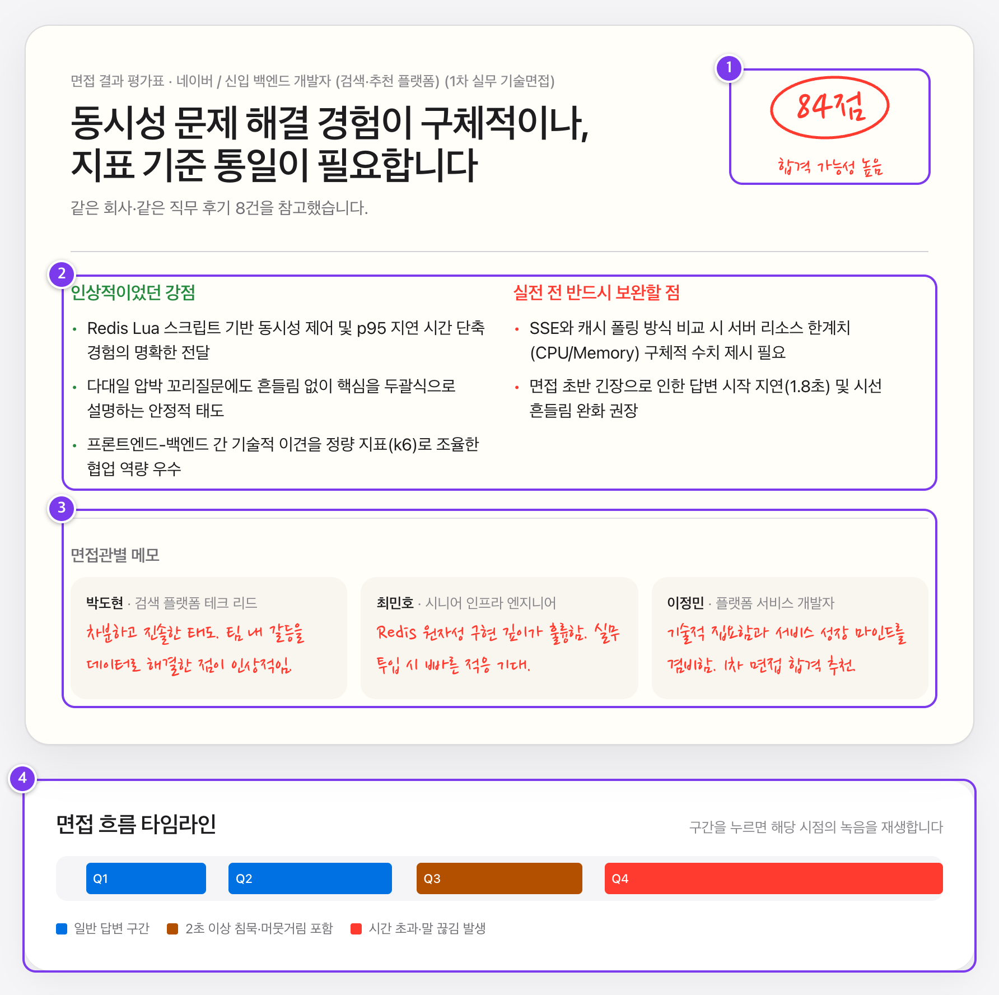 | 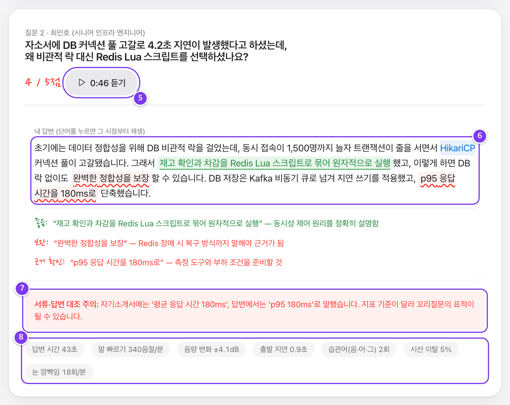 |

- **① 100점 만점 총점 및 합격 판정**: 종합 평가 점수, 합격 가능성 판정, 면접 난이도 대비 수행도를 한눈에 보여줍니다.
- **② 강점 및 핵심 보완점 종합 진단**: 두괄식 답변 태도, STAR 기법 준수 여부, 수치적 근거 제시율 등 전체 면접 태도와 역량을 분석합니다.
- **③ 면접관별 맞춤 심사평**: 실무자, 임원, 인사담당자 각자의 관점에서 지원자를 평가한 개별 심사평을 기록합니다.
- **④ 인터랙티브 오디오 타임라인**: 일반 답변 구간, **2초 이상 침묵 구간**, 제한시간 초과 구간을 색상으로 구분합니다. 타임라인 특정 블록을 클릭하면 해당 시점의 녹음이 즉각 재생됩니다.
- **⑤ 문항별 원클릭 오디오 다시 듣기**: 전체 오디오를 일일이 탐색할 필요 없이, 문항 카드 상단의 재생 버튼으로 해당 질문에 대한 내 답변만 즉시 청취할 수 있습니다.
- **⑥ 단어 단위 동기화 및 형광펜/빨간펜 첨삭**:
  - STT 단어 타임스탬프를 오디오 플레이어와 1:1 바인딩하여, **답변 텍스트 내 특정 단어를 클릭하면 해당 단어를 발화한 정확한 순간부터 오디오가 재생**됩니다.
  - 모범 표현은 **녹색 형광펜**, 보완이 필요한 장황한 표현이나 추임새는 **빨간색 물결 밑줄**로 표시됩니다.
- **⑦ 서류-답변 불일치 경고 (모순 검출)**: 지원자가 제출한 이력서/자기소개서 상의 수치(프로젝트 기간, 매출 성장률 등)와 실제 구두 답변 간 불일치가 발생할 경우 경고 배지와 함께 모순된 지점을 짚어줍니다.
- **⑧ 정량 태도 지표 리포트**: 답변 소요 시간, 분당 발화 속도(WPM), 음량 편차(dB), 첫마디 출발 지연 시간, 습관어(추임새) 빈도, 시선 이탈률, 눈 깜빡임 횟수 등 정량 데이터를 차트와 수치로 시각화합니다.

---

### 5) 사용자 후기 수집 및 데이터 환류 루프

실제 면접을 치른 사용자가 후기를 등록하고, 관리자가 검수한 후 시스템 데이터셋에 자동 편입되는 지속적 데이터 확장 루프를 제공합니다.

| 5-1. 사용자 면접 후기 작성 | 5-2. 관리자 데이터 검수 대시보드 |
| :---: | :---: |
| 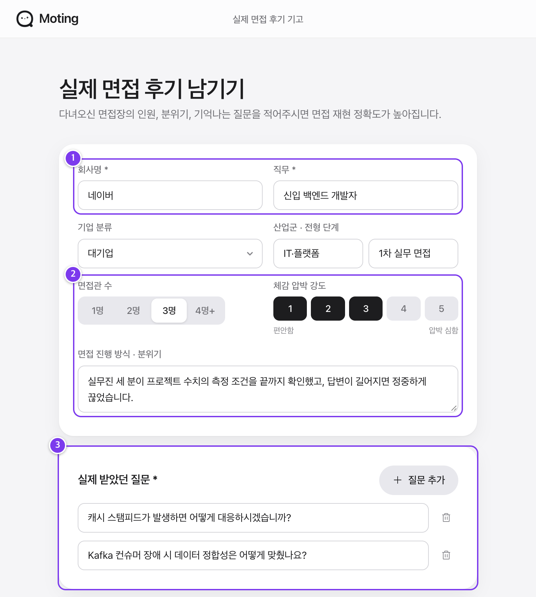 | 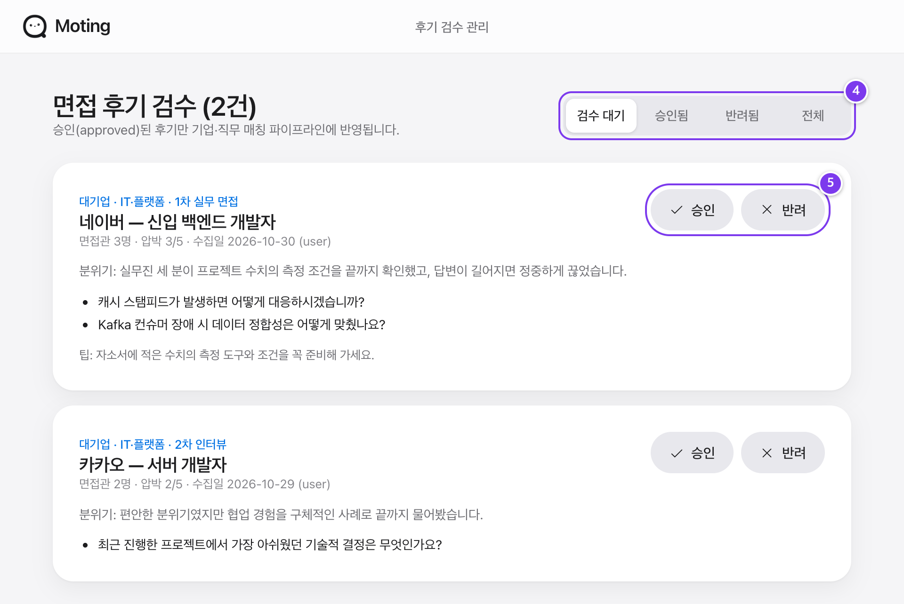 |

- **① 기업 및 직무 메타데이터**: 실제 면접을 치른 기업명, 채용 구분, 직무를 태깅하여 데이터베이스에 적재합니다.
- **② 전형 환경 프로파일링**: 면접관 수(1인~다수), 체감 압박도(1~5점), 면접 진행 분위기, 주요 전형 특징을 수집합니다.
- **③ 기출 질문 누적 적재**: 실제 면접장에서 받은 기출 질문들을 복수 등록하여, 추후 동일 기업/직무 모의면접 시 기출 질문 풀에 자동 반영됩니다.
- **④ 검수 워크플로우 관리 (`/admin`)**: 등록된 후기를 `검수 대기`, `승인 완료`, `반려` 상태로 필터링하고 관리할 수 있습니다.
- **⑤ 승인 즉시 서비스 반영**: 관리자가 승인한 후기는 실시간 벡터 임베딩(`gemini-embedding-001`)과 함께 데이터베이스에 등록되어, 차기 면접장 생성 시 유사도 매칭 대상에 즉시 편입됩니다.

---

## 3. 개발 결과 및 데이터셋 아키텍처

### 가. 초기 면접 후기 데이터셋

모팅 초기 버전에는 지인 인터뷰 및 검증된 공개 데이터를 통해 정제한 **실제 면접 후기 186건**의 데이터셋이 탑재되어 있습니다.

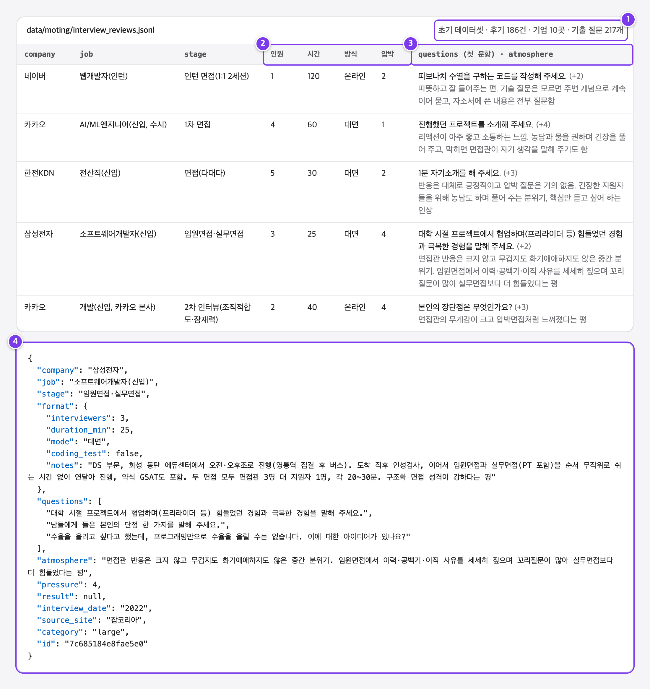

- **규모**: 후기 **186건**, 주요 기업 **10곳**, 실제 기출 질문 **217개** 수록
  - 기업 분포: 네이버(44건), 삼성전자(39건), 카카오(37건), LG전자(30건), SK하이닉스(10건), 토스(6건), 한국전력공사(6건), ETRI(5건), 한전KDN(5건), KISA(4건)
  - 별도 공통 직무 기본 질문 데이터셋 **2,269개** 내장
- **정형 메타 필드 (38건 완전체)**: 면접관 수, 소요 시간, 진행 방식, 1~5단계 압박 강도
- **서술형 텍스트 필드**: 실제 기출 질문(76건) 및 면접장 분위기 서술(54건)
- **임베딩 매칭 엔진**: `gemini-embedding-001`을 통해 생성된 256차원 벡터 임베딩 코사인 유사도와 키워드 BM25 점수를 결합한 하이브리드 검색 알고리즘 적용

---

### 나. 시스템 아키텍처 및 데이터 플로우

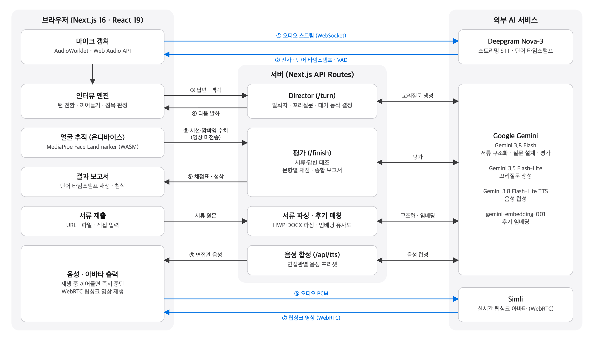

#### 1) 기술 스택 & 인공지능 모델 매트릭스

| 모델 / 기술 | 공식 용도 | 특장점 |
| :--- | :--- | :--- |
| **Next.js 16 (App Router) + React 19** | 풀스택 웹 프레임워크 | 서버 컴포넌트, 고속 스트리밍, 정적 파일 서빙 |
| **Gemini 3.8 Flash** | 서류 구조화, PDF 판독, 질문 설계, 종합 평가 | 멀티모달 고속 인텔리전스, 대용량 컨텍스트 |
| **Gemini 3.5 Flash-Lite** | 턴마다 다음 발화 및 꼬리질문 실시간 생성 | 초저지연 LLM 추론 (< 400ms) |
| **Gemini 3.8 Flash-Lite TTS** | 면접관 페르소나별 자연스러운 음성 합성 | 한국어 억양 및 남/여 페르소나 보이스 |
| **gemini-embedding-001** | 후기 매칭용 256차원 임베딩 | 고정밀 시맨틱 코사인 유사도 연산 |
| **Deepgram Nova-3** | 스트리밍 한국어 STT, 단어 타임스탬프, VAD | 초저지연 음성인식, 단어별 시작/끝 시각 반환 |
| **MediaPipe Face Landmarker** | 브라우저 온디바이스 시선·눈 깜빡임 추출 | 서버 전송 없는 완벽한 개인정보 보호 |
| **Simli Trinity-2** | WebRTC 실시간 오디오-립싱크 비디오 스트리밍 | 발화 음성에 정확히 동기화된 얼굴 모션 |

#### 2) 종단 간 데이터 플로우

1. **마이크 입력 및 STT 스트리밍 (①②)**: 지원자의 마이크 오디오가 Web Audio Worklet을 통해 16kHz PCM으로 리샘플링되어 Deepgram WebSocket으로 직접 스트리밍되며, 실시간 전사 텍스트가 브라우저 인터뷰 엔진으로 수신됩니다.
2. **Director 에이전트 지휘 (③④)**: 인터뷰 엔진이 지원자의 답변 전사본을 Director 서버 API로 전송하면, Gemini 3.5 Flash-Lite가 답변의 완성도, 수치 근거 유무, 자소서 모순 여부를 판단하여 다음 발화(꼬리질문 또는 다음 질문자 교대)를 결정합니다.
3. **TTS 합성 및 WebRTC 립싱크 재생 (⑤⑥⑦)**: 결정된 발화 텍스트가 Gemini TTS로 합성된 후 Simli 인프라로 전송되어, WebRTC 스트림을 통해 면접관 아바타의 자연스러운 입모양 영상으로 사용자 화면에 실시간 재생됩니다.
4. **온디바이스 평가 및 종합 리포트 생성 (⑧⑨)**: 면접이 끝나면 MediaPipe가 측정한 시선/깜빡임 지표와 STT 단어 타임스탬프가 최종 평가 엔진으로 집약되어, 불일치 검증과 단어 단위 오디오 첨삭 리포트가 완성됩니다.

---

### 다. 기존 AI 모의면접 솔루션 대비 차별성

| 비교 항목 | 기존 AI 면접 솔루션 | **모팅 (Moting)** | 사용자 체감 효과 |
| :--- | :--- | :--- | :--- |
| **면접 환경** | 획일화된 공통 고정 질문 세트 | **실제 후기 186건 기반 분위기·압박도 정밀 매칭** | 가고자 하는 기업·직무의 실제 특성에 최적화된 연습 |
| **면접관 구성** | 1인 챗봇 중심의 단순 질의응답 | **최대 3인 다대일 패널 (직함·음성·성향 독립)** | 다대일 면접 환경에서의 시선 처리와 다각도 질문 대응력 훈련 |
| **화면 인터랙션** | 정적 이미지 또는 텍스트 전용 UI | **WebRTC 립싱크 아바타 + 대기 제스처 연출** | 발화자뿐만 아니라 다른 면접관들의 반응을 실시간 관찰 |
| **오디오 복기** | 전체 녹음 파일 일괄 재생 (탐색 불편) | **단어 클릭 시 해당 구간 즉시 정밀 재생** | 취약하거나 버벅거린 발화 지점을 1초 만에 찾아 복기 |
| **답변 검증** | 단순 어휘·문법·키워드 매칭 | **제출 서류(자소서·이력서)와 답변의 불일치·모순 검출** | 서류에 쓴 내용과 입으로 말한 내용의 오류를 사전 교정 |
| **데이터 진화** | 솔루션 개발사 수동 업데이트 의존 | **사용자 후기 수집 및 관리자 검수 환류 루프** | 실제 기출 데이터와 질문 풀이 지속적으로 자동 확장 |
